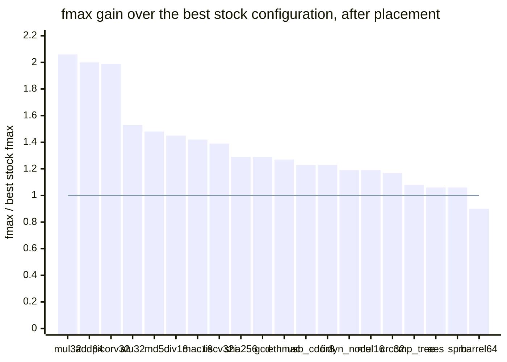
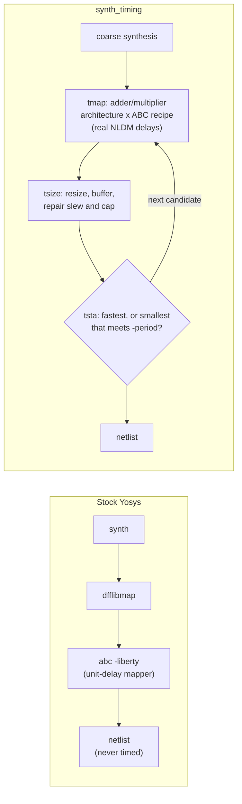

# Timing-aware Yosys

> **Written by Claude.** This fork of [Yosys](https://github.com/YosysHQ/yosys) adds timing-aware
> synthesis. It was built by **Claude, an AI model made by Anthropic**, working in Claude Code at
> the request of the owner of this fork. It is not part of upstream Yosys and has not been reviewed
> by YosysHQ, so please don't report problems with it to the Yosys maintainers.

`synth_timing` takes RTL and a liberty library and returns a sized gate-level netlist. Without a
clock period it builds the fastest netlist it can; with `-period` it returns the smallest one that
meets that period, trading area for timing.

## Results at a glance

20 designs, SkyWater 130 nm (`sky130_fd_sc_hd`, typical corner). Each design is compared with the
**fastest of 17 stock Yosys configurations** for that design, including the ORFS script and all
LibreLane ABC strategies.

| | fmax gain (geomean) | Faster on | Area |
|---|---|---|---|
| Before layout | **1.57x** | 20 of 20 | 1.15x |
| After OpenROAD placement and repair | **1.33x** | 19 of 20 | 1.11x |
| Designs held out of all tuning (aes, ethmac) | 1.48x / 1.16x | 2 of 2 | 1.03x / 1.00x |



The line at 1.0 is the best stock netlist; only barrel64 ends below it after placement.

| Design | Best stock fmax | `synth_timing` fmax | Gain (before / after placement) |
|---|---|---|---|
| picorv32 (RISC-V CPU) | 207 MHz | 529 MHz | 2.55x / 1.99x |
| mul32 (32x32 multiplier) | 124 MHz | 286 MHz | 2.30x / 2.06x |
| add64 (64-bit adder) | 263 MHz | 569 MHz | 2.17x / 2.00x |
| riscv32i (RISC-V CPU) | 207 MHz | 365 MHz | 1.77x / 1.39x |
| ethmac (held out) | 246 MHz | 465 MHz | 1.89x / 1.27x |
| aes (held out) | 291 MHz | 337 MHz | 1.16x / 1.06x |

fmax figures are before layout (OpenSTA). Also measured: none of the 140 timing-aware netlists
violates max slew or max capacitance (75 of 337 stock netlists do), and 99 of 140 are formally
proven equivalent, none different.

## What changes compared with stock Yosys



## Quick start

Build exactly like upstream Yosys (see [Building from Source](#building-from-source)), then:

```
read_verilog design.v
synth_timing -top top -liberty sky130_fd_sc_hd__tt_025C_1v80.lib              # fastest
synth_timing -top top -liberty sky130_fd_sc_hd__tt_025C_1v80.lib -period 2.5  # smallest meeting 2.5 ns
tsta -paths 5                                                                  # report timing
write_verilog -noattr netlist.v
```

`tmap` logs every candidate it tried and marks the one it kept (alu32, no period):

```
  candidate                    wns [ns]  period [ns] fmax [MHz]         area
  default/speed                 -1.8915       1.8915     528.69     11029.33
  ks/speed                      -1.7594       1.7594     568.39     11815.08  <-- selected
  ks/speed2                     -1.8133       1.8133     551.49     12289.29
```

**Trading area for timing** (alu32, `-period` relaxed from its fastest period):

| `-period` | Achieved period | Area | vs fastest |
|---|---|---|---|
| none (fastest) | 1.76 ns | 11,815 | |
| 2.11 ns | 2.10 ns | 10,332 | -13% |
| 3.52 ns | 3.31 ns | 8,627 | -27% |
| 5.28 ns | 5.19 ns | 7,774 | -34% |

## Commands

| Command | What it does |
|---|---|
| `synth_timing` | RTL to a sized netlist; `-period`, `-input_delay`, `-output_delay`, `-load`, `-wire_cap`, `-effort 0/1/2` |
| `tmap` | Builds candidates (architecture x mapping recipe), sizes and times each, keeps the best |
| `tsize` | Timing-driven gate sizing and buffering, then area recovery |
| `tsta` | Static timing analysis with the library's NLDM tables (within 1.1 ps of OpenSTA on 477 netlists) |
| `timing_setup` | Stores the liberty file and constraints for the other commands |

The commands also work on an existing netlist: `timing_setup -liberty lib.lib -period 5; tsta; tsize`.

**Limitations:** one ideal clock, no SDC, no hold checks, pre-route timing only, flat designs.
Default effort takes about 2.3x the runtime of the ORFS flow; `-effort 0` is faster.

**More:** [design, results and limitations](docs/timing_aware_synthesis.md) ·
[benchmark and verification scripts](examples/timing) · tests in `tests/timing`.

---

yosys – Yosys Open SYnthesis Suite
===================================

This is a framework for RTL synthesis tools. It currently has
extensive Verilog-2005 support and provides a basic set of
synthesis algorithms for various application domains.

Yosys is using [sv-elab](https://github.com/povik/sv-elab) and [slang](https://github.com/MikePopoloski/slang) libraries to provide comprehensive SystemVerilog support.
It supports an (informally defined) synthesizable subset of SystemVerilog in version IEEE 1800-2017 or IEEE 1800-2023.

Yosys can be adapted to perform any synthesis job by combining
the existing passes (algorithms) using synthesis scripts and
adding additional passes as needed by extending the yosys C++
code base.

Yosys is free software licensed under the ISC license (a GPL
compatible license that is similar in terms to the MIT license
or the 2-clause BSD license).

Third-party software distributed alongside this software
is licensed under compatible licenses.
Please refer to `abc` and `libs` subdirectories for their license terms.


Web Site and Other Resources
============================

More information and documentation can be found on the Yosys web site:
- https://yosyshq.net/yosys/

If you have any Yosys-related questions, please post them on the Discourse group:
- https://yosyshq.discourse.group

Documentation from this repository is automatically built and available on Read
the Docs:
- https://yosyshq.readthedocs.io/projects/yosys

Users interested in formal verification might want to use the formal
verification front-end for Yosys, SBY:
- https://yosyshq.readthedocs.io/projects/sby/
- https://github.com/YosysHQ/sby

The Yosys blog has news and articles from users:
- https://blog.yosyshq.com


Installation
============

Yosys is part of the [Tabby CAD Suite](https://www.yosyshq.com/tabby-cad-datasheet) and the [OSS CAD Suite](https://github.com/YosysHQ/oss-cad-suite-build)! The easiest way to use yosys is to install the binary software suite, which contains all required dependencies and related tools.

* [Contact YosysHQ](https://www.yosyshq.com/contact) for a [Tabby CAD Suite](https://www.yosyshq.com/tabby-cad-datasheet) Evaluation License and download link
* OR go to https://github.com/YosysHQ/oss-cad-suite-build/releases to download the free OSS CAD Suite
* Follow the [Install Instructions on GitHub](https://github.com/YosysHQ/oss-cad-suite-build#installation)

Make sure to get a Tabby CAD Suite Evaluation License if you need features such as industry-grade SystemVerilog and VHDL parsers!

For more information about the difference between Tabby CAD Suite and the OSS CAD Suite, please visit https://www.yosyshq.com/tabby-cad-datasheet

Many Linux distributions also provide Yosys binaries, some more up to date than others. Check with your package manager!


Building from Source
====================

### TL;DR

The following libraries are required, this command will install them on Ubuntu Linux 22.04 LTS based systems:

  $ sudo apt-get install gawk git make python3 lld bison clang flex \
		libffi-dev libfl-dev libreadline-dev pkg-config tcl-dev zlib1g-dev \
		graphviz xdot

This sequence of commands will build Yosys from source using the default preset:

	$ git clone --recurse-submodules https://github.com/YosysHQ/yosys.git
	$ cd yosys
	$ cmake --preset default
	$ cmake --build build --parallel $(nproc)

For release builds, substitute the cmake commands with these:

	$ cmake --preset release
	$ cmake --build build-rel --config Release --parallel $(nproc)

To run tests, run the following:

  $ export BUILD_DIR=$(realpath build-rel) && make -C tests -j"$(nproc)" vanilla-test

### Detailed instructions

For more details, and instructions for other platforms, check [building from
source](https://yosyshq.readthedocs.io/projects/yosys/en/latest/getting_started/installation.html#building-from-source) and [running the tests](https://yosyshq.readthedocs.io/projects/yosys/en/latest/yosys_internals/extending_yosys/test_suites.html)
on Read the Docs.

Getting Started
===============

Yosys can be used with the interactive command shell, with
synthesis scripts or with command line arguments. Let's perform
a simple synthesis job using the interactive command shell:

	$ ./build/yosys
	yosys>

the command ``help`` can be used to print a list of all available
commands and ``help <command>`` to print details on the specified command:

	yosys> help help

reading and elaborating the design using the Verilog frontend:

	yosys> read -sv tests/simple/fiedler-cooley.v
	yosys> hierarchy -top up3down5

writing the design to the console in the RTLIL format used by Yosys
internally:

	yosys> write_rtlil

convert processes (``always`` blocks) to netlist elements and perform
some simple optimizations:

	yosys> proc; opt

display design netlist using ``xdot``:

	yosys> show

the same thing using ``gv`` as postscript viewer:

	yosys> show -format ps -viewer gv

translating netlist to gate logic and perform some simple optimizations:

	yosys> techmap; opt

write design netlist to a new Verilog file:

	yosys> write_verilog synth.v

or using a simple synthesis script:

	$ cat synth.ys
	read -sv tests/simple/fiedler-cooley.v
	hierarchy -top up3down5
	proc; opt; techmap; opt
	write_verilog synth.v

	$ ./yosys synth.ys

If ABC is enabled in the Yosys build configuration and a cell library is given
in the liberty file ``mycells.lib``, the following synthesis script will
synthesize for the given cell library:

	# read design
	read -sv tests/simple/fiedler-cooley.v
	hierarchy -top up3down5

	# the high-level stuff
	proc; fsm; opt; memory; opt

	# mapping to internal cell library
	techmap; opt

	# mapping flip-flops to mycells.lib
	dfflibmap -liberty mycells.lib

	# mapping logic to mycells.lib
	abc -liberty mycells.lib

	# cleanup
	clean

If you do not have a liberty file but want to test this synthesis script,
you can use the file ``examples/cmos/cmos_cells.lib`` from the yosys sources
as simple example.

Liberty file downloads for and information about free and open ASIC standard
cell libraries can be found here:

- http://www.vlsitechnology.org/html/libraries.html
- http://www.vlsitechnology.org/synopsys/vsclib013.lib

The command ``synth`` provides a good default synthesis script (see
``help synth``):

	read -sv tests/simple/fiedler-cooley.v
	synth -top up3down5

	# mapping to target cells
	dfflibmap -liberty mycells.lib
	abc -liberty mycells.lib
	clean

The command ``prep`` provides a good default word-level synthesis script, as
used in SMT-based formal verification.


Additional information
======================

The ``read_verilog`` command, used by default when calling ``read`` with Verilog
source input, does not perform syntax checking.  You should instead lint your
source with another tool such as
[Verilator](https://www.veripool.org/verilator/) first, e.g. by calling
``verilator --lint-only``.


Building the documentation
==========================

Note that there is no need to build the manual if you just want to read it.
Simply visit https://yosys.readthedocs.io/en/latest/ instead.
If you're offline, you can read the sources, replacing `.../en/latest`
with `docs/source`.

In addition to those packages listed above for building Yosys from source, the
following are used for building the website:

	$ sudo apt install pdf2svg faketime

Or for MacOS, using homebrew:

	$ brew install pdf2svg libfaketime

PDFLaTeX, included with most LaTeX distributions, is also needed during the
build process for the website.  Or, run the following:

	$ sudo apt install texlive-latex-base texlive-latex-extra latexmk

Or for MacOS, using homebrew:

	$ brew install basictex
	$ sudo tlmgr update --self
	$ sudo tlmgr install collection-latexextra latexmk tex-gyre

The Python package, Sphinx, is needed along with those listed in
`docs/source/requirements.txt`:

	$ pip install -U sphinx -r docs/source/requirements.txt

DOCS (e.g.)

	$ cmake --build build --target docs-html --parallel

This will build/rebuild yosys as necessary before generating the website
documentation from the yosys help commands.  To build for pdf instead of html,
use the `docs-latexpdf` target.
